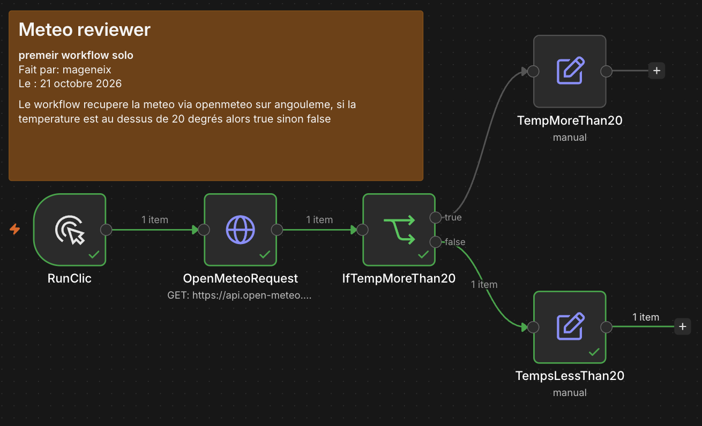

# ex00 — Meteo reviewer

## 🎯 Objectif
L'objectif de cet exercice est de recupérer la météo d'Angouleme au moment ou se lance le workflow et de lancer un set apres un if si la température dépasse ou non les 20 degrés.

---

## 🧩 Notions abordées & Nœuds utilisés

* **`[RunCLick]`** : Lance le workflow quand on clique dessus
* **`[OpenMeteoRequest]`** : Lance une requete vers OpenMeteo via leur api pour recuperer des donnees sur le meteo actuellement (avec option current) et a Angouleme (avec la configuration de la latitude et longitude)
* **`[IfTempMoreThan20]`** : Si la temperature a Angouleme depasse les 20 degres -> true sinon -> false 

---

## 📊 Schéma du Workflow

```text
[Trigger] ➔ [http request] ➔ [if] ┬➔ (True)  [set]
                                  └➔ (False) [set]
```


## ⚙️ Configuration & Dépendances

* Api et services externes : Open-Meteo
* Credentials necessaires : Aucun, API ouverte
* Variables a modifier : latitude, longitude, current