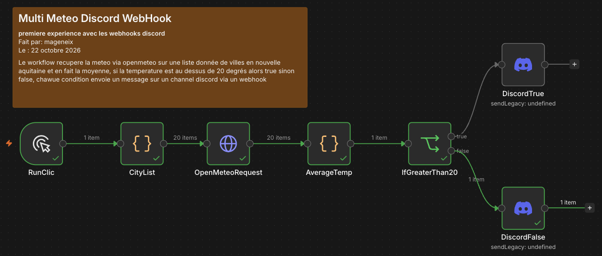

# ex01 — Multi Meteo

## 🎯 Objectif
L'objectif de cet exercice est de recupérer la météo d'une liste de ville donnée de nouvelle aquitaine au moment ou se lance le workflow, d'en faire la moyenne et de lancer un set apres un if si la température moyenne dépasse ou non les 20 degrés.

---

## 🧩 Notions abordées & Nœuds utilisés

* **`[RunCLick]`** : Lance le workflow quand on clique dessus
* **`[CityList]`** : Code node JavaScript qui va return une liste de ville avec leurs coordonnées.
* **`[OpenMeteoRequest]`** : Lance une requete vers OpenMeteo par ville via leur api pour recuperer des donnees sur le meteo actuellement (avec option current) et avec la configuration de la latitude et longitude de chaque ville presente dans le json en import.
* **`[AverageTemp]`** : Code node JavaScript qui va return le nombre de villes analysées et la moyenne de tempéraure de toutes ces villes.
* **`[IfTempMoreThan20]`** : Si la température moyenne dépasse les 20 degrés -> true sinon -> false 
* **`[DiscordTrue/DiscordFalse]`** : Message discord qui annonce le nombre de villes comptées et la temperature moyenne.

---

## 📊 Schéma du Workflow

```text
[Trigger] ➔ [Code JS] ➔ [http request] ➔ [Code JS] ➔ [if] ┬➔ (True)  [Discord Message]
                                                          └➔ (False) [Discord Message]
```


## ⚙️ Configuration & Dépendances

* Api et services externes : Open-Meteo, Discord
* Credentials necessaires : Discord, url du webhook
* Variables a modifier : latitude, longitude, current, average, Discord credentials