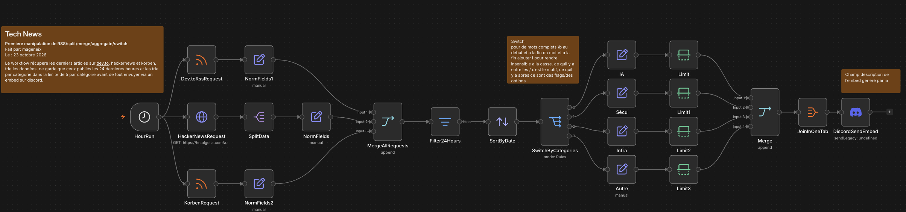

# ex02 — Tech News

## 🎯 Objectif
L'objectif de cet exercice est de récupérer chaque matin à 8h les derniers articles tech de Hacker News, dev.to et Korben, de ne garder que ceux publiés dans les dernières 24h, de les classer par catégorie (IA / Sécu / Infra / Autre, 5 articles max par catégorie) et d'envoyer le tout dans un seul embed Discord.

---

## 🧩 Notions abordées & Nœuds utilisés

* **`[HourRun]`** : Schedule Trigger qui lance le workflow tous les jours à 8h (plus besoin de cliquer comme dans ex00 et ex01)
* **`[HackerNewsRequest]`** : Lance une requête vers l'API Algolia de Hacker News pour récupérer les dernières stories (`tags=story`) avec plus de 50 points (`points>50`), 100 résultats max (`hitsPerPage=100`)
* **`[SplitData]`** : Split Out sur le champ `hits`, la réponse JSON de HN contient tous les articles dans un tableau, on la découpe pour avoir 1 item par article
* **`[Dev.toRssRequest]`** / **`[KorbenRequest]`** : Lecture des flux RSS de dev.to et Korben, pas besoin de split, le nœud RSS renvoie directement 1 item par article
* **`[NormFields]`** / **`[NormFields1]`** / **`[NormFields2]`** : Set qui normalise les champs, chaque source a ses propres noms de champs (`created_at`, `pubDate`, `link`...) donc on ramène tout à `Title` / `Url` / `Date`
* **`[MergeAllRequests]`** : Merge à 3 entrées qui regroupe les articles des 3 sources en une seule liste
* **`[Filter24Hours]`** : Ne garde que les articles dont la `Date` est après `$now.minus({hours: 24})`
* **`[SortByDate]`** : Trie les articles du plus récent au plus ancien
* **`[SwitchByCategories]`** : Classe chaque article avec une regex sur son titre, la première règle qui matche gagne et tout le reste part dans Autre
  * IA : `/AI|IA|LLM|GPT|Claude|OpenAI|Gemini|agent|MCP/i`
  * Sécu : `/security|sécurité|faille|CVE|hack|vulnerability|exploit|malware|breach/i`
  * Infra : `/Linux|docker|Kubernetes|server|serveur|cloud|DevOps|database|Postgres/i`
  * Autre : regex vide, matche tout ce qui n'est pas passé dans les règles d'avant
* **`[IA]`** / **`[Sécu]`** / **`[Infra]`** / **`[Autre]`** : Set qui ajoute le champ `categorie` en gardant les autres champs (`includeOtherFields`)
* **`[Limit]`** / **`[Limit1]`** / **`[Limit2]`** / **`[Limit3]`** : Limite à 5 articles max par catégorie
* **`[Merge]`** : Merge à 4 entrées qui regroupe les 4 catégories
* **`[JoinInOneTab]`** : Aggregate qui met tous les items dans un seul tableau `data`, pour envoyer 1 seul message Discord au lieu de 1 par article
* **`[DiscordSendEmbed]`** : Envoie un embed "Actualité Tech" via un webhook Discord, l'expression de la description boucle sur les catégories et génère la liste des liens en markdown

### 💡 Ce que j'ai appris
* Les regex dans le Switch : le motif entre les `/`, les flags après (`i` pour être insensible à la casse), `\b` pour matcher des mots complets
* La différence entre Split Out (1 item ➔ N items) et Aggregate (N items ➔ 1 item)
* Le Merge à N entrées
* Le filtre de date avec `$now`
* Les expressions JS dans un champ Discord

---

## 📊 Schéma du Workflow

```text
               ┌➔ [HTTP HN] ➔ [Split Out] ➔ [Set] ┐
[Schedule 8h] ─┼➔ [RSS dev.to] ───────────➔ [Set] ┼➔ [Merge] ➔ [Filter 24h] ➔ [Sort] ➔ [Switch] ┬➔ [Set IA]    ➔ [Limit 5] ┐
               └➔ [RSS Korben] ───────────➔ [Set] ┘                                            ├➔ [Set Sécu]  ➔ [Limit 5] ┤
                                                                                               ├➔ [Set Infra] ➔ [Limit 5] ┼➔ [Merge] ➔ [Aggregate] ➔ [Discord]
                                                                                               └➔ [Set Autre] ➔ [Limit 5] ┘
```
<!--  -->

## ⚙️ Configuration & Dépendances

* Api et services externes : Hacker News (API Algolia), flux RSS dev.to et Korben, Discord
* Credentials nécessaires : Discord, URL du webhook (HN et RSS sans auth)
* Variables à modifier : heure du trigger, filtres HN (points, hitsPerPage), regex des catégories, Limit (5), couleur/titre de l'embed
